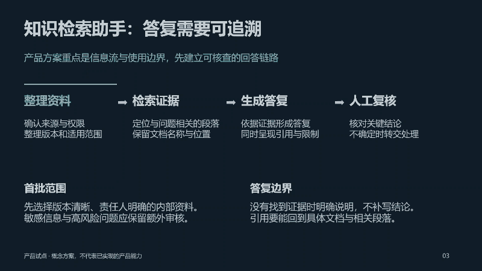

# Quiet PPT

**Content first. Restrained design. Ready to present.**

[English](README.md) · [简体中文](README.zh-CN.md) · [Skill instructions](quiet-ppt/SKILL.md) · [中文指令](quiet-ppt/SKILL.zh-CN.md)

An agent skill for editable PowerPoint presentations that selects a visual direction from the content, audience and occasion. It pairs useful on-slide explanations with speaker notes, and uses motion only when it helps explain a relationship.

**六类风格按内容匹配，正文适中，附逐页讲稿；不绑定轮盘、颜色或模板。**


## See it move

### A product flow, with a moving focus



### Optional annular image rotation


These GIFs are sampled from videos exported by desktop PowerPoint, not browser recreations. The annular treatment is an optional demonstration, **not the skill's default style**. The full examples use Chinese copy; the documentation and instructions are available in English and Chinese.

[Download the eight-slide style sampler](examples/content-matched-styles.pptx) · [Watch its full video](examples/content-matched-styles.mp4) · [Download the annular demo](examples/annular-morph.pptx) · [Watch the annular video](examples/annular-morph.mp4)

## What it changes

- **Match the content before styling.** An executive review, a product walkthrough and a training lesson need different evidence, composition and pacing.
- **Make the deck usable for the speaker.** Content slides include explanations, not just keywords. Speaker notes provide a natural talk track.
- **Separate style, layout and motion.** Keep one coherent style per normal deck, vary layouts with the evidence, and choose transitions independently.
- **Keep evidence editable.** Use native text, charts, tables and diagrams. Render every slide and distinguish file checks from actual playback checks.

This is a workflow skill with a small PPTX transition helper. Its contribution is a specific combination of defaults and decision rules, not a new rendering engine or a claim of benchmark superiority.

## Six starting directions

| Content | Direction | Evidence and composition |
| --- | --- | --- |
| Management review, project approval | Executive | Clear conclusions, native charts, action tables |
| Experiments, analysis, research | Research | Methods, units, limitations and direct chart labels |
| Product, architecture, implementation | Product/technology | System flows, interfaces and traceable relationships |
| Culture, community, brand narrative | Editorial/brand | Purposeful photographs and asymmetric text/image layouts |
| Training and explanation | Teaching | Concepts, examples, comparisons and practice steps |
| Space and design review | Architecture/portfolio | Images, plans, proportions and concise annotations |

These are adaptable starting points, not six fixed templates. A normal deliverable uses one main direction. The eight-slide sampler deliberately contains four separate two-slide groups for comparison.

## Install and use

Clone the repository and copy the **`quiet-ppt` folder** into your agent host's supported skills directory. Do not install the repository root as a skill.

For a repository-scoped Codex installation, copy it into `<your-project>/.agents/skills/quiet-ppt`. Current local Codex discovery locations are documented in [OpenAI's skill documentation](https://learn.chatgpt.com/docs/build-skills). Existing desktop setups may provide a different managed directory; follow the location exposed by that host.

```text
Use $quiet-ppt to turn these notes into an eight-slide management presentation.
Choose the style from the audience and evidence. Include useful explanations,
speaker notes and restrained transitions.
```

```text
请用 $quiet-ppt 将这些材料做成 8 页管理层汇报。
先按内容选择风格，正文提供足够解释，备注附讲稿，动效保持克制。
```

`quiet-ppt/SKILL.md` is the English entry point. For a Chinese entry point, use the contents of `quiet-ppt/SKILL.zh-CN.md` as the installed `SKILL.md`. Install one entry point per skill name.

## Runtime and helper

The instructions need a capable agent and an available editable-presentation authoring tool. This repository does not bundle an authoring engine, fonts, PowerPoint or an AI service. Output quality still requires review of the actual content and renders.

The optional transition helper uses **Python 3.10+ and the standard library only**:

```bash
python quiet-ppt/scripts/set_transitions.py draft.pptx animated.pptx --morph-slides 3 --duration 0.85
```

It sets destination slide 3 to object Morph and ordinary slides to fade, with a fallback for players that do not support Morph. The input and output must differ; an existing output is rejected. First create matching `!!object-name` objects on adjacent slides and define their different end states. The helper does not build masks, layouts or per-object animation sequences. See [motion guidance](quiet-ppt/references/motion.en.md).

## Examples and checks

| Example | Included | Checked |
| --- | --- | --- |
| Content-matched styles | Four two-slide groups, editable chart/table/diagram, speaker notes | Rendered in desktop PowerPoint; chart resize/save/reopen; PPTX structure and layout checks |
| Annular Morph | Three native picture segments with a shared rotation center, editable text, speaker notes | Rendered and exported by desktop PowerPoint; video frames reviewed |

Video previews use short automatic holds for browsing. The PPTX files use click-to-advance for a live presentation. Other presentation players may render or play transitions differently. Example business numbers are synthetic, the bookstore is fictional, and photographs illustrate atmosphere rather than a real project.

Run the deterministic helper tests with:

```bash
python -m unittest discover -s tests -v
```

## Sources and license

The instructions and helper were written for this project. Reviewed references include [Anthropic's PPTX skill](https://github.com/anthropics/skills/tree/main/skills/pptx), [frontend-slides](https://github.com/zarazhangrui/frontend-slides) and Microsoft's Morph documentation; no implementation or template was copied from those projects. See [third-party notices](THIRD_PARTY.md).

Original instructions, code and presentation layouts are [MIT licensed](LICENSE). Embedded third-party photographs retain their original licenses and are excluded from that grant. The supplied Bilibili recording is not redistributed.
