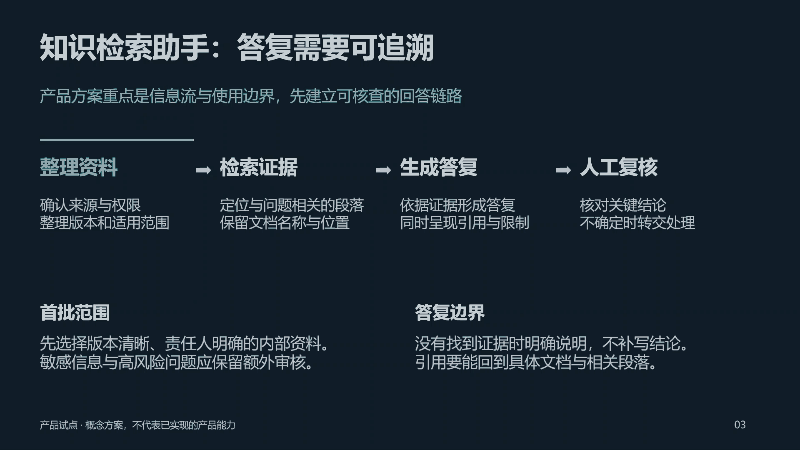
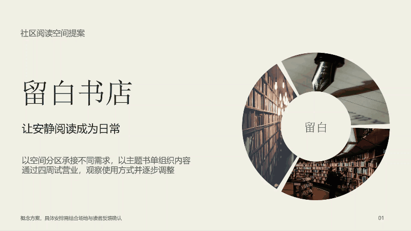

# Quiet PPT · 克制高级 PPT

**先理解内容，再决定风格，让演讲者能够直接汇报。**

[English](README.md) · [简体中文](README.zh-CN.md) · [英文指令](quiet-ppt/SKILL.md) · [中文指令](quiet-ppt/SKILL.zh-CN.md)

一个根据内容、受众与场景选择视觉方向的 Agent Skill。默认生成文字适中、带逐页讲稿的可编辑 PowerPoint，用明确的信息层次和必要的动效帮助讲述。

**不绑定轮盘、配色或模板。** 风格、单页版式和动效分别判断。


## 动画预览

### 产品流程中的焦点移动



### 可选的圆环图片旋转



动图取自桌面 PowerPoint 原生导出的视频，未用网页动画替代。圆环只是专项演示，**调用 Skill 不会自动套用此样式**。现有完整样例使用中文，项目说明和 Skill 指令提供英中两个版本。

[下载四组八页风格样例](examples/content-matched-styles.pptx) · [观看完整视频](examples/content-matched-styles.mp4) · [下载圆环动画样例](examples/annular-morph.pptx) · [观看圆环视频](examples/annular-morph.mp4)

## 主要能力

- **按内容选风格**：经营复盘重视结论和证据，产品方案重视信息流，培训重视概念与练习，不只更换颜色。
- **演讲者可直接使用**：正文保留观点及解释，备注附自然的讲稿，减少临时补写。
- **风格与动效分开选择**：一套普通成品保持统一主风格，按证据变化布局，仅在有意义时使用运动。
- **证据保持可编辑**：使用原生文字、图表、表格与关系图，逐页检查，并区分文件验证和实际播放验证。

项目的独立价值在于这套默认决策与工作流的组合，不宣称发明了新的渲染技术，也没有用基准测试证明优于其他项目。

## 六类可扩展方向

| 内容与场景 | 方向 | 呈现重点 |
| --- | --- | --- |
| 经营复盘、项目审批、管理层汇报 | 商务决策 | 结论、原生图表、行动表格 |
| 数据分析、实验与研究 | 数据研究 | 口径、方法、限制、直接标注 |
| 产品介绍、系统架构、实施方案 | 科技产品 | 流程、界面和可追溯关系 |
| 文化、社区与品牌故事 | 品牌编辑 | 有意义的照片、非对称图文构图 |
| 培训、课程与方法讲解 | 教学讲解 | 概念、例子、比较与练习步骤 |
| 空间、设计评审与作品集 | 建筑作品 | 图像、图纸、比例与说明 |

这些是设计起点，不是六套固定模板。普通汇报选一个主方向并保持一致；本仓库的八页样例为便于比较，特意分成四组、每组两页。

## 安装与调用

克隆仓库后，将 **`quiet-ppt` 文件夹**复制到使用的 Agent 支持的 Skill 目录，不要把整个仓库根目录当作 Skill 安装。

在 Codex 项目中，可放到 `<你的项目>/.agents/skills/quiet-ppt`。当前本地发现路径参见 [OpenAI 官方 Skill 文档](https://learn.chatgpt.com/docs/build-skills)。已有桌面环境可能提供单独的管理目录，优先使用宿主实际显示的位置。

```text
请用 $quiet-ppt 将这些材料做成 8 页管理层汇报。
先按内容选择风格，正文提供足够解释，备注附讲稿，动效保持克制。
```

```text
Use $quiet-ppt to turn these notes into an eight-slide management presentation.
Choose the style from the audience and evidence, with speaker notes.
```

默认入口 `quiet-ppt/SKILL.md` 为英文，完整中文指令在 `quiet-ppt/SKILL.zh-CN.md`。需要中文入口时，将后者的内容用作安装目录中的 `SKILL.md`。同名 Skill 只安装一个入口。

## 运行环境与辅助脚本

需要能够理解 Skill 的 Agent，以及可制作可编辑演示文稿的工具。本项目不捆绑渲染引擎、字体、PowerPoint 或 AI 服务。实际输出仍需结合材料与页面渲染复核。

可选转场脚本仅依赖 **Python 3.10+ 标准库**：

```bash
python quiet-ppt/scripts/set_transitions.py draft.pptx animated.pptx --morph-slides 3 --duration 0.85
```

该命令在目标第 3 页写入对象 Morph，其余页使用淡化，并提供不支持 Morph 时的后备分支。输入输出必须不同，输出文件不能已存在。使用前需在相邻页建立对应的 `!!对象名`，并设计不同终态。脚本不会自动生成蒙版、布局或逐项动画。[查看动效说明](quiet-ppt/references/motion.md)。

## 样例与检查范围

| 样例 | 包含内容 | 已完成的检查 |
| --- | --- | --- |
| 四组八页风格样例 | 不同场景的四组页面，原生图表、表格、关系图及逐页讲稿 | 桌面 PowerPoint 逐页渲染、图表缩放保存再打开、PPTX 结构与布局验证 |
| 圆环旋转样例 | 共用旋转中心的三个原生图片分区、可编辑文字与讲稿 | 桌面 PowerPoint 渲染及原生视频导出、视频画面复核 |

视频为快速预览而采用较短停留时间，PPTX 正式放映按点击换页。其他播放器的显示和动效可能不同。样例经营数字为演示数据，书店为虚构项目，照片仅用于氛围表达。

运行辅助脚本测试：

```bash
python -m unittest discover -s tests -v
```

## 参考与许可

本项目重新编写了指令、辅助代码及样例布局。研究过 [Anthropic PPTX Skill](https://github.com/anthropics/skills/tree/main/skills/pptx)、[frontend-slides](https://github.com/zarazhangrui/frontend-slides) 与 Microsoft Morph 文档，没有复制这些项目的实现或模板。详见[第三方说明](THIRD_PARTY.md)。

原创指令、代码和布局使用 [MIT 许可](LICENSE)。样例中嵌入的第三方照片保留原有许可，不包含在 MIT 授权中。
